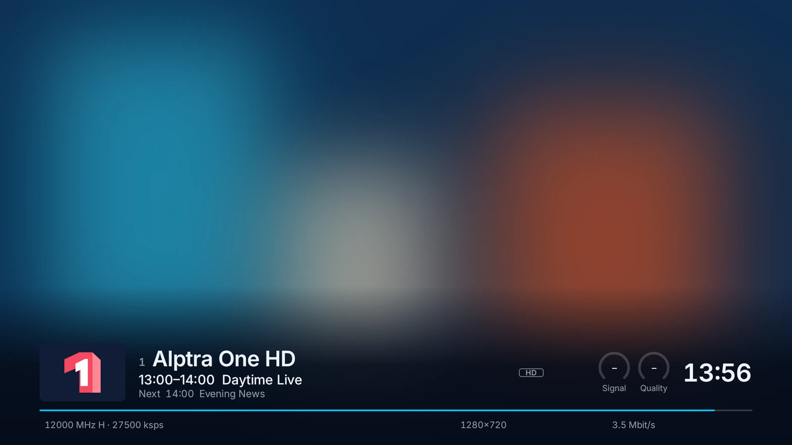
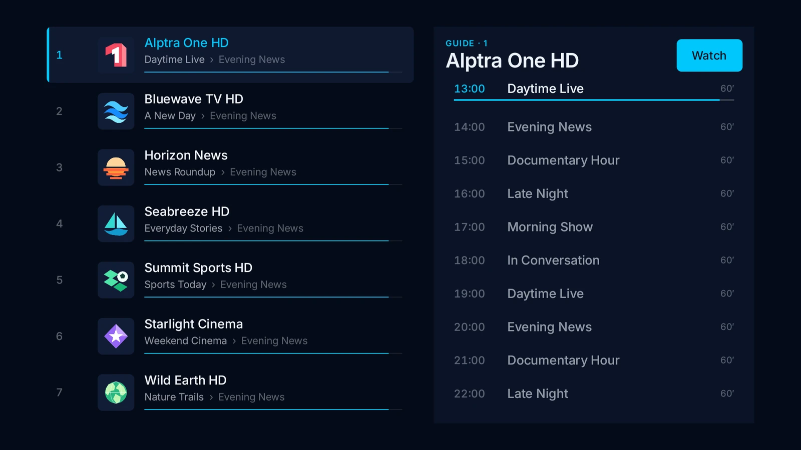
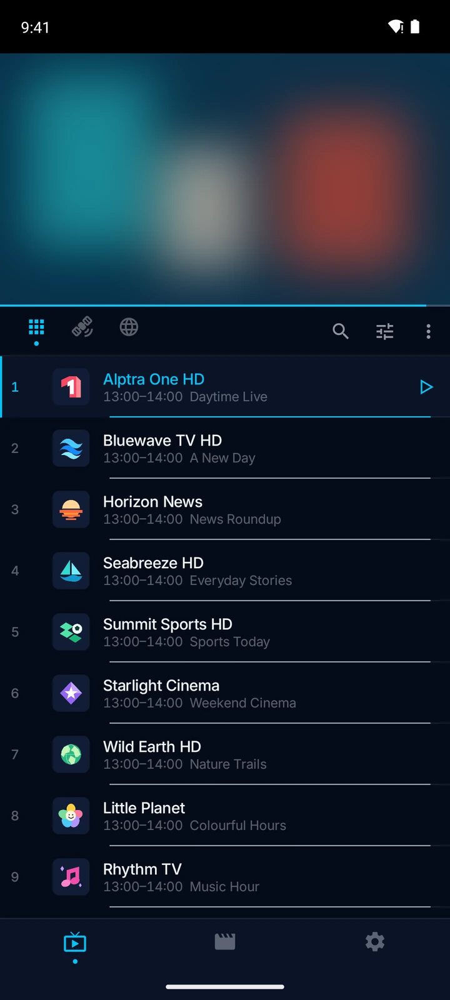
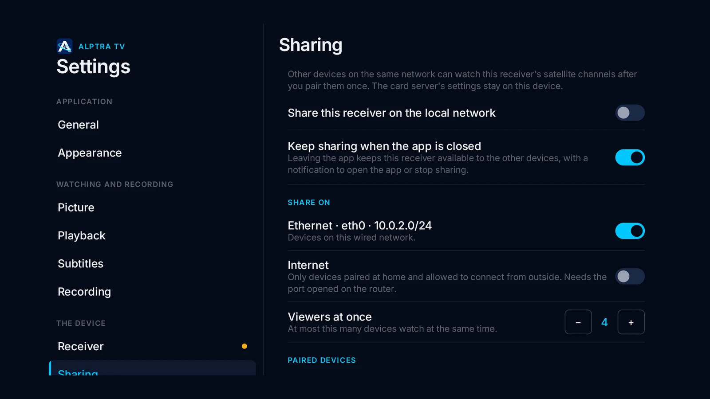

<p align="center">
  
</p>

<h1 align="center">Alptra TV</h1>

<p align="center">
  Satellite and IPTV player for Android phones, tablets and Android TV.<br>
  <a href="https://alptra.xacnio.dev">Website</a> ·
  <a href="https://github.com/xacnio/alptra-tv-android/releases/latest">Latest release</a> ·
  <a href="README_tr.md">Türkçe</a>
</p>

<p align="center">
  
  
</p>

Free, no account needed. This repository hosts the Android downloads.

<p align="center">
  <a href="https://github.com/xacnio/alptra-tv-android/releases/latest"></a>
  <a href="https://apps.obtainium.imranr.dev/redirect?r=obtainium://add/https://github.com/xacnio/alptra-tv-android"></a>
</p>

## Download

Get the APK from the [latest release](https://github.com/xacnio/alptra-tv-android/releases/latest):

| File | For |
|---|---|
| `alptra-tv-<version>-universal.apk` | Any device. **Not sure? Take this one.** |
| `alptra-tv-<version>-arm64-v8a.apk` | Phones and newer TV boxes |
| `alptra-tv-<version>-armeabi-v7a.apk` | Mi Box and most TV boxes |
| `alptra-tv-<version>-x86_64.apk` | Emulators |

Requires Android 7.0 or later. Once installed, the app updates itself and shows what's new.

With Obtainium, the app also stays up to date from this repository.

## Verifying a download

Every APK is signed with the same key, and Android won't install an update signed with a
different one. The certificate's SHA-256 is:

```
31:CC:B8:29:DC:3D:B2:7B:B2:13:14:08:81:15:6F:4D:D0:E1:3E:78:74:1A:C6:2D:5E:15:71:43:FA:DF:61:63
```

Check it with `apksigner verify --print-certs <file>.apk`. Each release also lists SHA-256
checksums and VirusTotal scans.

## Features

- Satellite TV from a USB receiver: DVB-S/S2, channel scan with TKGS, blind scan
- SAT>IP receivers, and sharing your USB receiver with other devices at home
- M3U and Xtream Codes playlists, in one list with your satellite channels
- Programme guide (broadcast and XMLTV) and teletext with Turkish characters
- Film and series library with profiles and Continue watching
- Recording, scheduled recording and pausing live TV
- YouTube, Twitch and Kick channels
- Built for the remote on Android TV

<p align="center">
  
  
</p>

## Contact

Found a bug or have an idea? [Open an issue](https://github.com/xacnio/alptra-tv-android/issues/new/choose)
or write to [alptra@xacnio.dev](mailto:alptra@xacnio.dev).
Support the project: [Buy Me a Coffee](https://buymeacoffee.com/xacnio)

© 2026 Alperen Çetin
