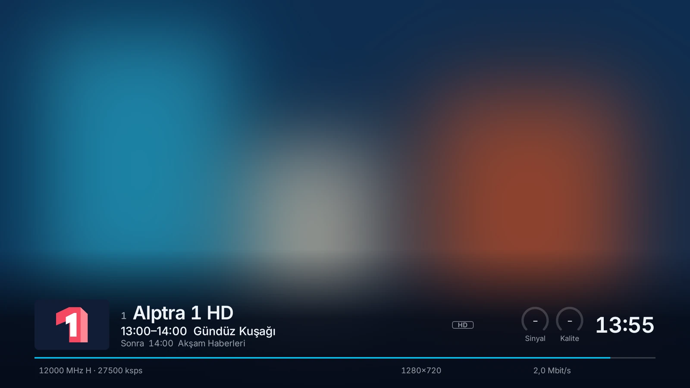
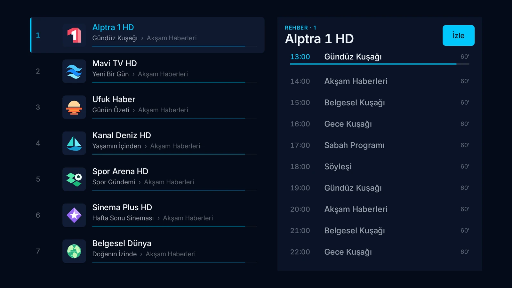
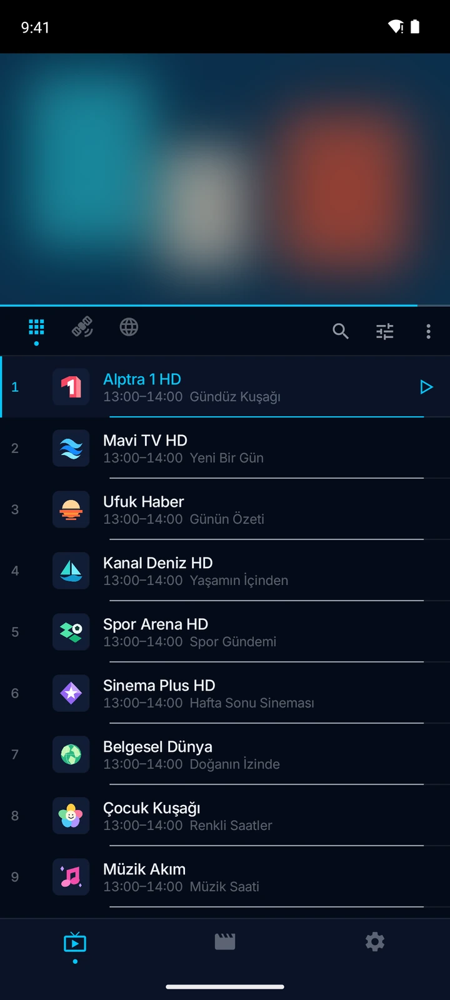
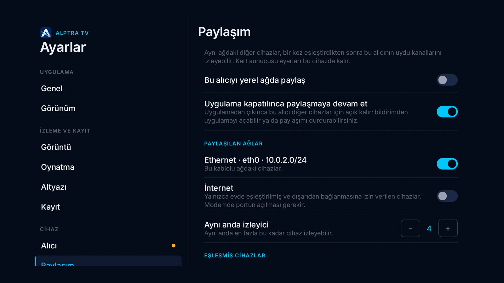

<p align="center">
  
</p>

<h1 align="center">Alptra TV</h1>

<p align="center">
  Android telefon, tablet ve Android TV için uydu ve IPTV oynatıcısı.<br>
  <a href="https://alptra.xacnio.dev">Web sitesi</a> ·
  <a href="https://github.com/xacnio/alptra-tv-android/releases/latest">Son sürüm</a> ·
  <a href="README.md">English</a>
</p>

<p align="center">
  
  
</p>

Ücretsiz, hesap gerekmez. Bu depoda Android indirmeleri var.

<p align="center">
  <a href="https://github.com/xacnio/alptra-tv-android/releases/latest"></a>
  <a href="https://apps.obtainium.imranr.dev/redirect?r=obtainium://add/https://github.com/xacnio/alptra-tv-android"></a>
</p>

## İndir

APK'yı [son sürümden](https://github.com/xacnio/alptra-tv-android/releases/latest) indir:

| Dosya | Kimin için |
|---|---|
| `alptra-tv-<sürüm>-universal.apk` | Her cihaz. **Emin değilsen bunu al.** |
| `alptra-tv-<sürüm>-arm64-v8a.apk` | Telefonlar ve yeni TV kutuları |
| `alptra-tv-<sürüm>-armeabi-v7a.apk` | Mi Box ve çoğu TV kutusu |
| `alptra-tv-<sürüm>-x86_64.apk` | Emülatörler |

Android 7.0 veya üstü gerekir. Kurduktan sonra uygulama kendini günceller ve yenilikleri gösterir.

Obtainium ile kurarsan uygulama bu depodan da güncel kalır.

## İndirdiğin dosyayı doğrulama

Tüm APK'lar aynı anahtarla imzalanır; Android başka bir anahtarla imzalanmış güncellemeyi kurmaz.
Sertifikanın SHA-256 değeri:

```
31:CC:B8:29:DC:3D:B2:7B:B2:13:14:08:81:15:6F:4D:D0:E1:3E:78:74:1A:C6:2D:5E:15:71:43:FA:DF:61:63
```

`apksigner verify --print-certs <dosya>.apk` ile kontrol edebilirsin. Her sürümde SHA-256 değerleri
ve VirusTotal taramaları da var.

## Özellikler

- USB alıcıdan uydu yayını: DVB-S/S2, TKGS ile kanal tarama, kör tarama
- SAT>IP alıcılar ve USB alıcını evdeki diğer cihazlarla paylaşma
- M3U ve Xtream Codes listeleri, uydu kanallarınla tek listede
- Yayın akışı (yayından ve XMLTV'den) ve Türkçe karakterli teletext
- Profilli film ve dizi kitaplığı, İzlemeye devam et
- Kayıt, zamanlanmış kayıt ve canlı yayını duraklatma
- YouTube, Twitch ve Kick kanalları
- Android TV'de kumandayla rahat kullanım

<p align="center">
  
  
</p>

## İletişim

Bir hata mı buldun, bir fikrin mi var? [Issue aç](https://github.com/xacnio/alptra-tv-android/issues/new/choose)
ya da [alptra@xacnio.dev](mailto:alptra@xacnio.dev) adresine yaz.
Projeye destek: [Buy Me a Coffee](https://buymeacoffee.com/xacnio)

© 2026 Alperen Çetin
